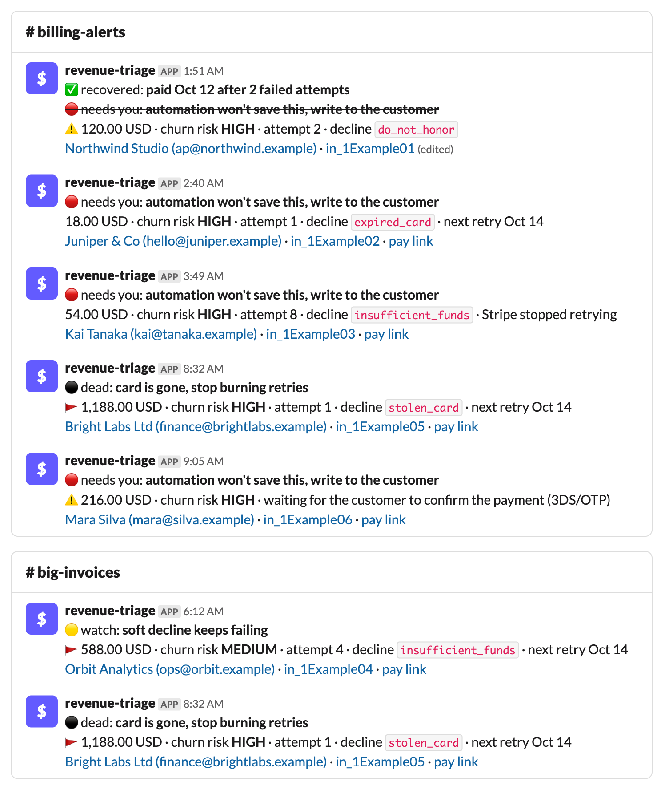
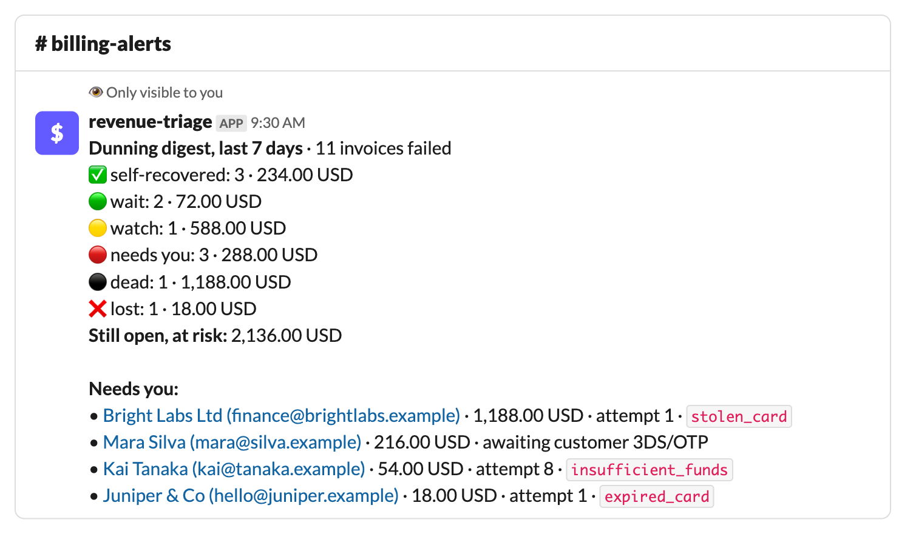

# revenue-triage

Stripe dunning triage for Slack. One stateless server: Stripe webhooks → "is this a problem yet?" → a Slack ping only when an invoice *becomes* one, rewritten in place as recovered once it's paid; plus Slack slash commands (`/digest`) for on-demand summaries.

Not an alerter: hundreds of failed-payment events a month collapse into the couple of dozen that need a human.

## What it looks like

Pings, routed by [`config.example.yml`](config.example.yml): `needs_you` and `dead` go to the billing channel, anything from `watch` up over 500 USD also goes to a big-invoices channel. The top ping has been rewritten in place after the customer paid.



`/digest`, on demand, for the last 7 days:



_Rendered from `engine.py` with made-up customers._

## States

The decline code beats the attempt counter.

| State | Rule |
|---|---|
| 🟢 wait | soft decline, fewer than `watch_from_attempt` attempts |
| 🟡 watch | soft decline, `watch_from_attempt` or more |
| 🔴 needs you | hard decline, or Stripe stopped retrying (`next_payment_attempt` is null) |
| ⚫ dead | card lost/stolen (`decline_codes.dead`) |

- The decline code is the failed charge's `outcome.reason`.
- A ping fires when an invoice moves into a worse state than its previous attempt left it in. The previous state is rebuilt from the previous charge, so a restart never re-pings.
- On `invoice.paid`, the bot finds its pings for that invoice by the invoice id in their text and rewrites them: a ✅ headline, and the old headline struck through. Invoices that never pinged are left alone.
- Nothing is stored. Stripe is the record of payments, Slack is the record of pings.

## Scope

Read-only on Stripe, no database, no cron. It never retries a charge, emails a customer or writes to billing. New features come as new slash commands on the existing `/slack` endpoint; anything that needs memory between calls or a schedule is out of scope.

## Setup (Heroku)

Below, `$APP` is your Heroku app name and `$APP_URL` its web URL (`heroku apps:info -a $APP` → Web URL).

### 1. Slack app

1. In [`slack-app-manifest.json`](slack-app-manifest.json), replace `https://YOUR-APP-URL` with `$APP_URL`.
2. <https://api.slack.com/apps> → **Create New App** → **From a manifest** → pick the workspace → paste the manifest into the JSON tab → **Create**.
3. **Install to Workspace** → Allow.
4. Copy two values:
   - **OAuth & Permissions → Bot User OAuth Token** (`xoxb-...`) → `SLACK_BOT_TOKEN`
   - **Basic Information → App Credentials → Signing Secret** → `SLACK_SIGNING_SECRET`
5. In every channel the pings go to, run `/invite @revenue-triage`.
6. Copy each channel's id: channel name → **View channel details** → bottom of the About tab (`C0...`).

### 2. Stripe restricted key

Dashboard → Developers → API keys → **Create restricted key**. Give it **Read** on Invoices, Charges, Payment Intents and Events; leave everything else at None. The key (`rk_live_...`) → `STRIPE_API_KEY`. A missing permission shows up in `heroku logs` as `Enabling <X> Read ... would allow this request to continue`.

### 3. Stripe event destination

Dashboard → Developers → Webhooks → **Add destination**:

- **Scope:** Your account.
- **API version:** `2026-01-28.clover`.
- **Events:** All events tab → `invoice.payment_failed` and `invoice.paid`, nothing else.
- **Destination type:** Webhook endpoint.
- **URL:** `$APP_URL/stripe-webhook`
- Then **Reveal** the signing secret (`whsec_...`) → `STRIPE_WEBHOOK_SECRET`.

Stripe retries failed deliveries for up to 3 days, so events that arrive before step 5 are not lost.

### 4. Config

```bash
cp config.example.yml config.yml   # set the channel ids from step 1.6; tune routes and thresholds
heroku config:set -a $APP \
  TRIAGE_CONFIG="$(cat config.yml)" \
  STRIPE_API_KEY=rk_live_... \
  STRIPE_WEBHOOK_SECRET=whsec_... \
  SLACK_BOT_TOKEN=xoxb-... \
  SLACK_SIGNING_SECRET=...
```

`config.yml` is gitignored; after editing it, run the `TRIAGE_CONFIG` line again.

### 5. Deploy

```bash
heroku git:remote -a $APP
git push heroku main
heroku ps:type web=basic -a $APP   # not eco: an eco dyno sleeps, and a cold start misses Slack's 3s deadline
```

Run a single dyno: the Stripe-redelivery guard and the `/digest` background thread live in process memory.

### 6. Check

- `curl $APP_URL/` → `ok`
- Type `/digest` in Slack. You should see "Working on /digest…" right away, then the summary.
- `heroku logs --tail -a $APP` shows every webhook and any Slack/Stripe error.

## Tests

```bash
pip install -r requirements.txt pytest
pytest
```

## License

MIT, see [LICENSE](LICENSE).
